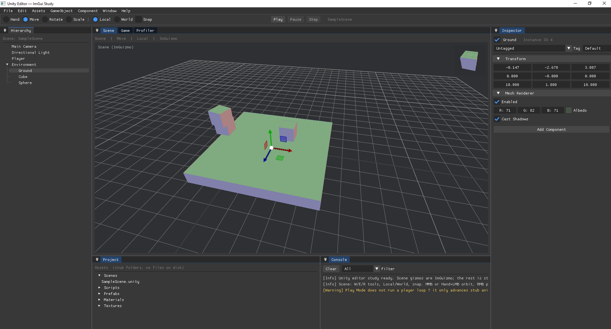

# Brutal.ImGui.GameEngine.Editor.Studies
A study repository of existing game engine editors written in Brutal.ImGui.

## Studies:
### Unity3D

### Unreal Engine

Mimics Unreal Editor's docking layout: Place Actors, Viewport, World Outliner, Details, Content Browser, Output Log, and a stub Play-in-Editor / Simulate toolbar.

Launch the app to pick a study from the selection screen. From an editor, use **File > Back to Study List** to return.
